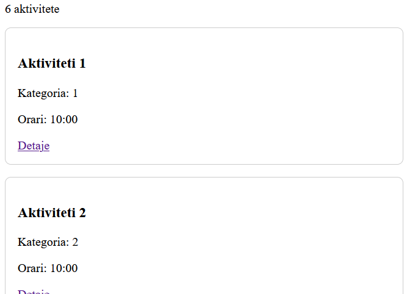
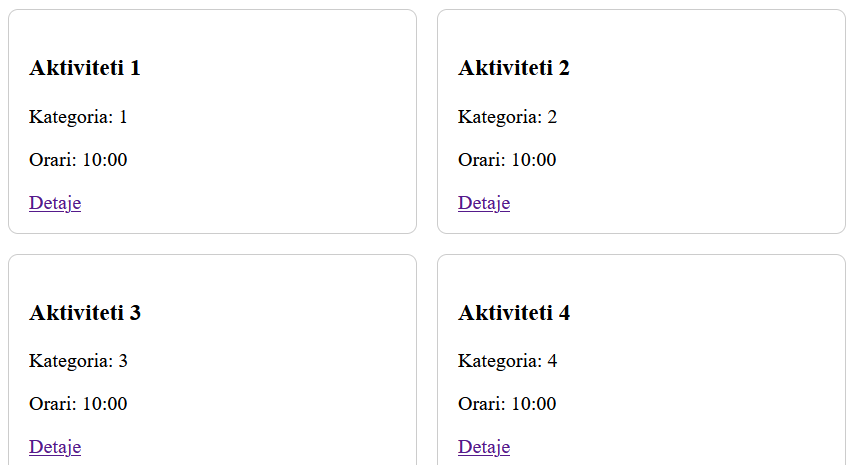
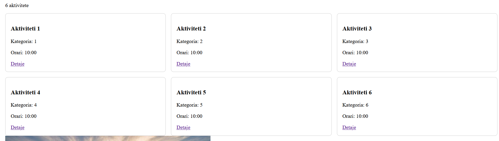

# Java IV — Festivali që përshtatet në çdo ekran

## Çfarë mëson

Flexbox, Grid, media queries dhe pamje responsive.

Referencë tematike: kap. 6–7 të librit.

## Skenari

Programi i një festivali shkencor duhet të lexohet si në telefon ashtu edhe në ekran të gjerë.

## Kërkesat

1. Krijo gjashtë karta aktivitetesh dhe një menu fleksibile.
2. Përdor Grid: një kolonë nën 600 px, dy nga 600 deri në 899 px dhe tri nga 900 px.
3. Kartat kanë titull, kategori, orar dhe lidhje detajesh; teksti i gjatë nuk duhet të dalë jashtë.
4. Përdor imazh fleksibël dhe mos përdor lartësi fikse për tekstin.
5. Testo në 360, 768 dhe 1280 px; ruaj rezultatet në README.

## Rastet e pranimit

- [y] Në 360/768/1280 px shfaqen përkatësisht 1/2/3 kolona.
- [y] Nuk ka scroll horizontal në faqen e plotë.
- [y] Menuja mbetet e përdorshme me tastierë.

## Sfida e transferimit

Një titull 100-karakterësh duhet të përshtatet pa prishur kartën. Kjo sfidë është formuese; nuk jep bonus jashtë rubrikës.

## Dorëzimi dhe GitHub

Puno në JavaIV/ të repository-t individual. Dorëzo kodin, asetet lokale dhe README.md me: çfarë realizove, hapat e hapjes, hyrje → rezultat i pritur → rezultat i marrë për testet, përgjigjen e reflektimit dhe deklarimin e AI/burimeve. Për React dorëzo edhe package.json dhe lockfile; mos dorëzo node_modules/ ose dist/.

## Reflektim individual

Kur do të zgjidhje Flexbox dhe kur Grid?
    - Grid kur duam te bejme layout ne forme te nje matrice, ndersa Flexbox kur rregullojme layout vetem per nje dimension
 
Kolonat:
    
    
    
Perdorimi mesatar i Claude